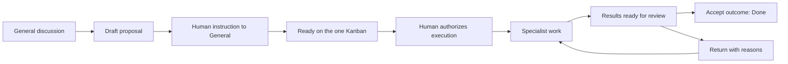

# Research Workspace Interaction Redesign

Status: design proposal, not implemented or an accepted ADR.

Reviewed on 2026-10-19 against Kubecode `e5acd42`. This proposal follows the
Workspace contract established by ADRs 0220-0226. Structural implementation
must supersede the affected accepted ADRs rather than edit them.

## Purpose

Make discussing a research question, delegating its execution, and judging its
results feel like one continuous activity. A researcher should see who is
speaking, what work a message concerns, and what decision needs their attention.
Execution infrastructure remains available through deliberate inspection.

The existing product decisions remain the basis of the design:

- One Workspace has one public General conversation and one Kanban.
- A research question is a top-level Task. Internal work is inside that Task.
- General is the project manager. Specialists perform concrete work.
- The researcher authorizes admission through their own words in General;
  General performs the admission. Adding a Task does not implicitly start it.
- Public collaboration uses mentions. Only human-agent DMs exist.
- Private material is shared only through a previewed, explicit operation.

## References and What to Borrow

DeepSeek Harness was inspected through its official page, official screenshot,
and source at `687f282e8625c6b8d11ff58211a90524be2e4317`. Its public landing page
threw a client-side exception in the audit browser; no live Harness app or
real-agent execution was tested.

- [Official overview and UI examples](https://deepseek.com/en/harness/)
- [Layout implementation and geometry](https://github.com/deepseek-ai/deepseek-harness/blob/687f282e8625c6b8d11ff58211a90524be2e4317/packages/client/ui-layout/README.md)
- [Composer and draft behavior](https://github.com/deepseek-ai/deepseek-harness/blob/687f282e8625c6b8d11ff58211a90524be2e4317/packages/client/ui-conversation/README.md)

Borrow the clear conversation focus, coherent composer, progressive disclosure
of tool activity, and an optional inspection surface that protects reading
space. Its single-session Send/Stop switching is unsuitable for a shared
conversation: Kubecode needs separate, explicitly scoped cancellation.

OpenAgents was inspected through its repository screenshot and Workspace
frontend at `7522d1c`. The screenshot is illustrative; current source provides
the stronger evidence for navigation and message behavior.

- [Workspace layout](https://github.com/openagents-org/openagents/blob/7522d1c/workspace/frontend/components/layout/app-sidebar.tsx)
- [Navigation and view state](https://github.com/openagents-org/openagents/blob/7522d1c/workspace/frontend/components/layout/layout-context.tsx)
- [Member identity, messages, and attached results](https://github.com/openagents-org/openagents/blob/7522d1c/workspace/frontend/components/chat/chat-message.tsx)
- [Mention input](https://github.com/openagents-org/openagents/blob/7522d1c/workspace/frontend/components/chat/chat-input.tsx)

Borrow visible member identity, inline mentions, contextual message actions,
and preservation of list state while inspecting an object. Kubecode's simpler
one-General/one-Kanban model does not need its entire navigation inventory or
an independent thread for each Task. These references inform interaction
choices; their branding, illustrations, plugin architecture, and provider
catalog are outside this proposal.

## Current UI Audit

The current application was exercised with fixture agents through its real
server and MCP endpoints, at desktop and phone widths. The following are
observable interaction problems, not missing backend features.

| Current surface | Problem | Target |
| --- | --- | --- |
| Workspace navigation | General sits above a persistent Sessions tree; the header searches Sessions; primary views have Back to Sessions | One Workspace hierarchy, with execution history as a secondary tool |
| General authors | The audit's manager messages display only `Agent`; names resolve through the Session catalog | Resolve public identity through member bindings, including historical bindings |
| Message actions | Reply and Reply in thread both appear on each message | One public reply interaction; preserve legacy thread links in history |
| General input | Discussion / Ask a Session / Request work require choosing an execution concept before speaking | One message action, mentions for recipients, explicit Task association |
| Message content | Plain paragraphs display research lists as raw text; Task and Research-ID references repeat the same object | Shared safe rich-text renderer; one named reference per object |
| Task inspection | Open and Ready appear together, brief versions repeat, and legacy Mark resolved / Archive sit above the Task workflow | One Task stage and one contextual decision surface |
| Navigation chrome | Multiple panel toggles and global/session controls compete with the main view | Named panel controls using one command vocabulary |
| Attention list | Every proposal counts as Needs you | Count explicit pending decisions, with ordinary proposals accessible separately |

Relevant ownership points:

- [WorkbenchShell](../../src/kubecode/app/WorkbenchShell.tsx) mounts Workspace
  navigation inside ProjectNavigator and wraps TaskInspector in ResearchWorkspace.
- [WorkspaceNav](../../src/kubecode/app/WorkspaceNav.tsx) owns navigation,
  attention entries, and member shortcuts.
- [MessageItem](../../src/kubecode/channel/MessageItem.tsx) and
  [channelLabels](../../src/kubecode/channel/channelLabels.ts) own public identity
  presentation and the overlapping reply actions.
- [MessageComposer](../../src/kubecode/channel/MessageComposer.tsx) owns message
  intent and scope; [Composer](../../src/components/workspace/Composer.tsx),
  [IconButton](../../src/components/workspace/IconButton.tsx), and
  [SendButton](../../src/components/workspace/SendButton.tsx) already supply
  useful shared controls.

## Workspace Frame

```text
Workspace selector       General / Kanban / Resources title       Search
---------------------    -----------------------------------------------
General                  Main view                  Optional inspector
Kanban                   conversation, board,       Task / member /
Resources                or resource list           evidence / execution
Needs you  [2]
---------------------    -------------------------  --------------------
Members                  Public conversation        One inspection stack
  General                preserves its draft        with Back and Close
  Analyst                and reading position
  Writer
Direct messages
  Analyst
---------------------
Execution history
Workspace settings
```

The sidebar starts at approximately 240px, is resizable, and can collapse.
No extra permanent icon rail is needed initially. Selecting a Workspace restores
its last primary view; a new Workspace opens General. Switching Workspaces
never falls through to an unrelated Session.

The inspector is one surface with a small navigation stack: Task -> evidence ->
back to Task. Opening a member replaces the inspected object while preserving
the main view. File, Git, and terminal tools use this surface or an explicit
expanded tool view; they do not add permanent columns.

On wide displays, keep a readable main column beside a roughly 400-560px
inspector. If their minimum widths do not fit, use a detail screen with Back.
On phones, use one content screen, a navigation sheet, and full-screen details.
Back restores scroll, filter, draft, and focus. Escape dismisses the nearest
popover or panel; it never silently stops running work.

Global search should search Workspace objects: messages, Tasks, members, and
resources. Until the necessary search contracts exist, label a search by its
actual scope. Merely renaming the existing Session search is insufficient.

## General Conversation

Use compact, left-aligned group conversation rows. A row has a stable member
avatar, display name, optional role, timestamp, content, and relevant Task or
resource references. Provider logos are secondary metadata, not member identity:
General and Analyst may use the same provider.

Consecutive messages from the same member can share a visual group. Full date
and time belong in a tooltip; date separators establish chronology. Deleted or
replaced members retain historical identity. An unresolved identity is explicit,
not presented as another indistinguishable `Agent`.

Reuse the existing safe Markdown, code, math, and reference rendering patterns.
Normal prose remains unframed. Proposals, decisions, and artifacts may have
compact structured presentations. A proposal shows its question, success
criteria, version, and Draft state once. One Task chip replaces duplicate
Task/Research-ID links to the same object.

Expose one Reply action. It quotes the source and writes into General. Replying
to an agent visibly inserts its mention; replying to a human leaves normal
General routing. The recipient is visible and editable before sending. Public
reply never becomes a DM. Existing execution-thread links remain accessible
through history, with their existing IDs and deep links.

Put secondary actions in a small hover/focus toolbar: reply, copy, link, more.
On touch devices expose a persistent more button. Avoid permanently dedicating
two rows per message to reply controls.

Publish meaningful collaboration events in General: a proposal, delegation,
blocker, finding, review request, or decision. Keep raw tool calls and repetitive
run events in an expandable activity summary or execution detail. Unread updates
must not scroll a researcher away from what they are reading.

## Composer Contract

| Situation | Behavior |
| --- | --- |
| Plain General message | Route to General; no intent selector |
| `@analyst` | Show a member suggestion with name, role, availability; route to the selected member in public |
| Several explicit mentions | Display all recipients; preserve existing routing limits |
| Task-scoped discussion | Show a removable Task chip above the input; send to General with that association |
| Reference attached | Show a named, versioned chip; attachment is context, not authorization |
| Agent is working | Sending remains available; show queued/delivered state according to actual backend events |
| Stop requested | Name the affected agent/run/Task; distinguish stopping a run from pausing orchestration |
| Submission fails | Preserve the text, recipients, references, and association; retry without duplicating the message |

The composer has an integrated auto-growing text area, a single add-context
menu, and a consistent arrow send action. Use `@` for members; the add-context
menu handles Tasks, findings, files, and imported discussions. Do not overload
an agent mention with permission to add, start, or complete a Task.

Hide provider/model/mode controls from General. They belong in member settings;
General's restricted mode remains locked. Direct technical Sessions may retain
their richer controls, using the same visual primitives and distinct semantics.

General and DM drafts are keyed separately by Workspace and destination. A
draft's Task association is explicit; changing a filter must not silently move
an existing draft to another Task. Preserve drafts through inspector and view
changes. Enter, Shift+Enter, IME composition, paste, and touch behavior continue
through the tested shared Composer.

Message receipt and agent response are separate states. A successful save can
clear the draft; a routing failure must remain visible on that message with a
retry action. UI labels must distinguish saved, queued, delivered, and failed
only where the server can establish those facts.

## Tasks and Research Decisions



Admission and execution currently use separate authorizing messages. Preserve
that behavior in the first UI implementation. Supporting one instruction such
as "add this and start" requires a deliberate authorization-model change, not
two frontend calls pretending the same message grants both actions.

Kanban has Ready, In progress, Review, and Done. Show blocked/waiting/paused as
conditions, not additional columns. A card shows its question title, specialist
participants, most recent meaningful update, and any required human action.
General is the default manager and need not consume the same line on every card.
Use real progress summaries, not invented completion percentages.

Board filters operate on this one board. Drafts remain outside its columns.
On mobile, select a stage and read its list rather than compress four columns.
Do not offer drag-to-Done or drag-to-start as shortcuts around review or execution
authorization. Reordering is a separate feature requiring persistent ordering.

Task detail is a Task-owned surface rather than a whole ResearchWorkspace nested
inside another detail page. Reuse its underlying readers and editors:

- Overview: question, criteria, approved brief version, owner, participants,
  current blocker, and next action.
- Results: findings, outcome, artifacts, comparisons, and pinned evidence.
- Activity: attempts, experiments, decisions, and expandable execution records.

An "Discuss in General" action opens the same General feed scoped to the Task
and focuses its composer. It does not create a second discussion store. Remove
legacy Mark resolved from the normal Task surface; the Task's accepted review
is the visible completion operation. Archive is a separate action in a menu.

Review actions keep text labels: Accept results and Return for changes. A
negative or inconclusive scientific result can still finish a Task. Evidence
loading and version validation are part of the action state: an unsuccessful
read cannot count as having inspected a version. A decision updates both the
Task and its existing General context.

## Members, DMs, and Attention

Members is one roster. General stays first and is clearly the manager. Add a
specialist through a compact dialog with name, role/template, and provider spec;
advanced instructions and permissions expand on demand. No Session creation
step should be necessary for the researcher.

A member row opens its profile; a labelled private-message action opens its DM.
Recent DMs are listed separately with a private indicator. Profile, mention
picker, message avatar, and Task participants share identity and availability
components. Configured/active membership is not proof that an agent is online
or currently executing; show only states supported by runtime data.

DM has the same composer mechanics, a visible private destination, and explicit
selection -> preview -> share to General. Switching views must not leak its
draft or history into General. Agent-to-agent contact remains public.

Needs you is a queue of pending decisions, not another chat or another board:
permissions, questions, review requests, and proposals explicitly awaiting a
decision. Selecting an entry opens the corresponding context. Distinguish
unread-message indicators from action counts; deduplicate the same pending
decision across its Task and run. Resolved entries disappear after server
acknowledgement. Ordinary drafts should not continually imply urgency.

## Icon and Control Vocabulary

Use the existing Lucide and shadcn stack for Workspace chrome. Define semantic
commands once and route consumers through shared controls, rather than relying
on every component choosing the same icon by convention. Keep provider branding
and file-type icons as separate identity/content systems.

| Meaning | Lucide icon | Presentation |
| --- | --- | --- |
| General | `Hash` | Navigation label + icon |
| Kanban | `Columns3` | Navigation label + icon |
| Resources | `Library` | Navigation label + icon |
| Needs you | `Inbox` | Label + pending-action count |
| Members | `Users` | Section label; `UserPlus` for adding |
| Private conversation | `MessageCircle`, `LockKeyhole` | Action icon; destination privacy indicator |
| Add context | `Plus` | Composer menu; `Paperclip` only where the operation specifically attaches a file |
| Send | `ArrowUp` | One fixed-size primary icon button |
| Stop current execution | `Square` | Separate action with a target-specific accessible label |
| Pause orchestration | `Pause` | Only where a real pause API exists |
| Reply / copy / link | `CornerUpLeft`, `Copy`, `Link2` | Contextual message toolbar |
| More / close / back | `Ellipsis`, `X`, `ArrowLeft` | Consistent menus and inspector navigation |
| Left / right panel | `PanelLeft`, `PanelRight` | Explicit panel toggles |
| Execution / terminal | `Activity`, `SquareTerminal` | Secondary tools |

Use 16px default glyphs, 18px primary composer glyphs, and 12px decorative
status marks, with a common stroke weight. Give compact desktop actions at
least a 32px hit area and touch actions 44px. Tooltip and accessible name must
describe the action, including its target when applicable. Keyboard focus is
visible. A tooltip must not be the sole place a destructive action is explained.

Keep navigation text, action labels for research decisions, and readable status
words. Icons replace repetitive mechanical controls, not the meaning of an
outcome or authorization. Active state, disabled state, busy state, hover, and
focus must be defined for every shared primitive without changing its geometry.

## Visual Direction

Use neutral light/dark surfaces, restrained borders, one interaction accent,
and distinct success/warning/error tones. Separate surfaces by spacing and thin
dividers. Cards belong to repeated Tasks and artifacts, not every page section.
Prefer 14px navigation/body controls, 15-16px conversation text, and 18-20px
panel headings. Keep letter spacing at zero and card radii at 6-8px.

The header communicates current location and context. Remove permanent
instructional paragraphs from General and Kanban; use concise destination
labels and contextual empty/error states. The composer should be one composed
surface, not a textarea followed by an unrelated form-control row. A stable
maximal reading width prevents a single message spanning the whole desktop.

## Implementation Boundaries and Order

| Slice | Main ownership | Completion evidence |
| --- | --- | --- |
| 1. Frame and member identity | WorkbenchShell, ProjectNavigator, WorkspaceNav, route state, channelLabels, member bindings | A new Workspace opens General; authors are distinct; view/Workspace switches preserve position; legacy links still work |
| 2. Conversation and composer | ChannelWorkspace, MessageItem, MessageComposer, DM, shared Composer, routing projection | One reply flow, no intent dropdown, visible recipients/scope, drafts survive failures, no private-to-public leakage |
| 3. Task and review surface | TaskBoardView, TaskInspector, extracted Research readers/editors, EvidenceViewer | One stage, one completion path, readable evidence, return-to-General continuity, mobile board |
| 4. Resources and attention | ResourcesView, reference pickers, permission/question/review projections | One preview surface and deduplicated pending actions; search labels match actual scope |
| 5. Shared controls and visual rollout | IconButton, SendButton, Icon, status/avatar primitives, CSS tokens, locale files | Same semantics across new and technical surfaces; keyboard/touch/dark/long-text checks |

Define the control vocabulary before slice 1, then migrate its call sites with
each slice. Avoid a stand-alone cosmetic pass that leaves the old information
hierarchy in place. These are code-coupling boundaries, not one issue per page.

Preserve current server IDs, MCP communication, Task authorizations, evidence
pins, and run ownership. Some presentation work needs data-contract additions:
historical member identity in messages, actionable routing status, aggregate
pending decisions, and Workspace-wide search. Confirm each existing projection
before adding an endpoint. Persisting new preferences or changing core
authorization/reply semantics requires an ADR and behavioral regression tests.

First implementation milestone: the Workspace frame plus a complete General
journey (new Workspace -> discuss with General -> mention a specialist -> inspect
a Task -> return to the same message). Include member identities and the shared
composer controls. Then implement Task review and the remaining surfaces.

## Acceptance Scenarios

1. A new Workspace creates its default manager, or shows an actionable setup
   state if its provider is unavailable. The first screen is General.
2. Public messages identify the correct member even after its Session changes.
3. The researcher discusses, revises, and authorizes a proposal in natural
   language; a mention or reference alone never grants authority.
4. General, DM, Task-scoped drafts, and Workspace switches preserve the intended
   destination. A failed send can be retried without losing or duplicating text.
5. Reply stays public; DM sharing shows exactly what will become public.
6. Opening Task, evidence, or execution detail and returning preserves the
   original message, filter, scroll, draft, and keyboard focus.
7. A changed, failed-to-load, or removed evidence source has an explicit decision
   state; acceptance never implies a version was viewed when loading failed.
8. Sending remains available while specialists work; Stop names its scope and
   never implies pausing the whole Workspace.
9. Review acceptance or return updates the board and reaches General; unread
   messages do not count as unanswered decisions.
10. Desktop, compact desktop, and phone layouts remain readable in both themes,
    with long translated text, keyboard navigation, and IME input.

This document records research and proposed behavior. It does not claim the
redesign, a real-agent pilot, or the outstanding evidence-load fix is complete.
